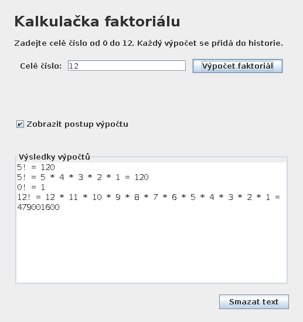

# Pokročilé programovací techniky (Java, JUnit 5)

Týmové projekty a cvičení z předmětu **Pokročilé programovací techniky** (VŠPJ, ZS 2026/27, tým T18). Hlavní témata: **jednotkové testy, hledání a oprava chyb, třívrstvá architektura a návrhové vzory**.

| Složka | Obsah |
|---|---|
| `projekt-01-banka` | bankovní účet s limity, nádrž, faktoriál – vlastní výjimky + **JUnit 5 testy** pro každou třídu |
| `projekt-02-prospech` | vyhodnocení prospěchu: nalezení a oprava chyb v dodaném kódu (`Seznam_chyb.txt`), logy před/po opravě, testy hraničních hodnot |
| `projekt-03-faktorial` | **kalkulačka faktoriálu ve Swingu** – vrstvy prezentace / logiky / dat, 60 testů včetně GUI testu přes `java.awt.Robot` |
| `cviceni-04-dvojbran` | výukové testy a výpočet dvojbranu (Maven) |
| `cviceni-06-csv` | import a export CSV ve třech formátech – **Factory, Builder, Provider**, statistiky tříd a studentů |



## Technologie

Java 17 · Swing · JUnit 5 · Maven · IntelliJ IDEA

## Jak spustit

Projekty s `pom.xml` (Maven):

```bash
cd projekt-03-faktorial
mvn test          # testy
mvn package       # sestavení
```

Bez Mavenu jde aplikaci přeložit i čistě přes JDK:

```bash
cd projekt-03-faktorial
javac -encoding UTF-8 -d out $(find src -name "*.java")
java -cp out cz.vspj.t18.Main
```

`projekt-01-banka` je projekt IntelliJ IDEA (`main/java`, `test/java`) – testy vyžadují JUnit 5 na classpath.

## Poznámky

- Týmová práce (tým T18), zveřejněno se souhlasem spoluautora.
- `projekt-02-prospech/src/Zpracovani.java` je kód dodaný v zadání s úmyslnými chybami; úkolem bylo je najít, popsat a opravit.

---
*Historie commitů odpovídá datům odevzdání v Moodlu. Ověřeno: zdrojové kódy všech projektů se přeloží přes JDK 21.*
